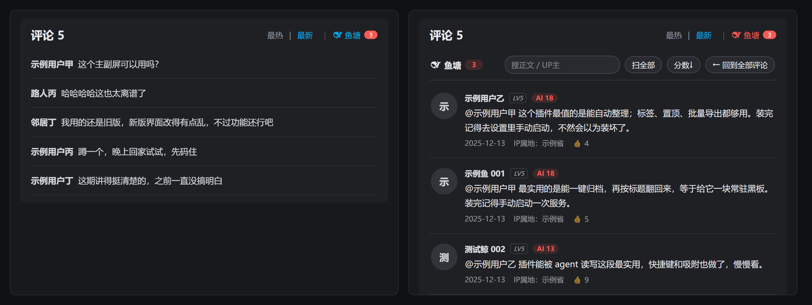

# B站鱼塘 · AI/推广评论收集器

[](https://github.com/Heidiefu27/bilibili-fishpond/actions/workflows/test.yml)
[](LICENSE)

一个 Tampermonkey 用户脚本：把 B 站评论区里**明显像 AI 生成 / 推广文案**的评论从原评论区里"收走"，集中放到「最热 / 最新」旁边的 **🐟 鱼塘** 页里，并且**就在原评论区的位置**就地切换，不开浮窗、不跳新页面。

> 它不是"关键词黑名单"，而是按**说话腔调**打分：结构、测评口吻、提示腔、功能罗列，再加人味反向分。详见[判定原理](#判定原理)。



*预览用本地模拟页面渲染，用户名均为示例。*

## 它做了什么

1. **接口层剔除**：拦下评论区接口（`/x/v2/reply*`），把判定为水军的评论直接从 JSON 里去掉 —— 原评论区压根不会渲染它，**不留空白坑，也不会闪一下**。
2. **DOM 兜底**：万一接口没拦住，就在新卡片出现的**那一拍**（浏览器绘制之前）隐藏它，并把数据登记进鱼塘。
3. **鱼塘页**：只收判定为水军的评论，排版照搬原评论区（头像 / 昵称 / 等级 / 正文 / 时间 / IP 属地 / 点赞），额外显示 AI 分数和判定依据。
4. **人工兜底**：`Alt+点击` 任何评论 = 手动投进鱼塘；每条鱼都能「放回评论区」（永久记住你的判断）。

## 安装

**一键安装**（需先装好 [Tampermonkey](https://www.tampermonkey.net/)）：

<https://raw.githubusercontent.com/Heidiefu27/bilibili-fishpond/main/bilibili-fishpond.user.js>

在浏览器里打开这个链接，Tampermonkey 会弹出安装页；装完打开任意视频页、滚到评论区，排序条右侧出现 `🐟 鱼塘` 即生效。

手动安装：打开本仓库的 `bilibili-fishpond.user.js` 全选复制，粘到 Tampermonkey 的「新建脚本」里保存即可。

> 脚本头部带 `@updateURL`，以后仓库一更新，Tampermonkey 会自动检查更新。

## 使用

| 操作 | 说明 |
|---|---|
| 点 `🐟 鱼塘` | 在原评论区位置切到鱼塘页 |
| 点 `最热 / 最新` 或 `← 回到全部评论` | 切回正常评论区 |
| `Alt+F` | 开关鱼塘 |
| `Alt+点击某条评论` | 手动投进鱼塘（不受判定限制） |
| 卡片上 `放回评论区` | 标记为真人，之后永不再收（刷新生效） |
| `⚙` | 收走开关、显示依据、**必须有 @**、阈值滑杆、复制全部、导出 |
| `重扫本页` | 用当前规则把已渲染的评论再扫一遍 |

鱼塘页顶部还有搜索框（正文 / UP 主）、按分数或时间排序。

## 判定原理

判定只看**怎么说**，不看说了什么，只有两步：

| 顺序 | 条件 | 不满足 |
|---|---|---|
| 1 | 必须 `@` 了人（这类水军的固定特征） | 没 @ → 放过 |
| 2 | 分数 ≥ 阈值（默认 6，可 3–12 调） | 低于阈值放过 |

**加分项**大致分四类：

- 结构：分号、破折号、顿号列举、多个冒号、长句高密度、空格断句
- 腔调：总结腔、提示腔（装完记得 / 不然会）、测评口吻（最实用 / 更戳我 / 没短板）、比喻解释（等于给它一块…）、建议试用（你试试 / 慢慢看）、评价表态（这句我认 / 太对了）、比较收益（比…省事多了）
- 推广：功能罗列（能…还能…）、产品 slug 名、ID 带"鱼 / 鲸"、`@` 了人、话题词命中、安利式 @人
- 反例（减分）：B 站表情、梗与口头禅、语气词、个人叙事、求助问法、感谢、叠字、太短、无标点

**"无任何人味特征 +3"**：够长、标点规整、没梗没语气词**且没有"我"** —— 这反而是机器写的典型特征。

话题词表在源码 `RE_TOPIC` 里，默认带了一些示例产品词（`DSH / DeepSeek / 便签 / 插件 / agent …`）。**换个圈子用，把那几个词换掉即可**，例如：

```js
// 源码里搜索 RE_TOPIC
const RE_TOPIC = /(你的产品名|你的插件名|关键词A|关键词B)/gi;
```

阈值、`@` 门槛、是否收走都可以在鱼塘的 `⚙` 里改，不用改代码。

**人工动作只在本页生效**：`Alt+点击` 投喂、`放回评论区` 都会立刻生效，但刷新后按上面的两步重新判定
（不写入跨页记忆，避免历史判断污染新页面）。

## 调试

F12 控制台里有个只读调试入口：

```js
__fishpond.diag()        // 钩子状态 / 拦到几次接口 / 剔掉几条 / 影子根数量 / 页签状态
__fishpond.pond          // 当前鱼塘里的评论（含分数与命中项）
__fishpond.scanned       // 本页扫到的全部评论（查"为什么没收某条"）
__fishpond.check('文本','昵称')  // 直接对一段文本跑完整判定
__fishpond.score('文本')         // 只看正文的腔调分
```

如果某条该收没收：先跑 `__fishpond.scanned.find(r => r.message.includes('关键词'))`
- 有结果但分数低 → 是规则问题，调阈值或补关键词
- 没有结果 → 那条数据没走脚本挂钩的接口，需要补 URL 匹配

## 隐私

- 脚本**不联网**、不上报任何数据、不读取 Cookie / 账号信息
- 只有两类数据存在你本地（Tampermonkey 存储）：设置项、鱼塘缓存（用于刷新后仍能看到收走的评论）
- 鱼塘缓存的键按视频 BV 号隔离，最多保留 120 条，超过 30 天的自动忽略
- 想彻底清空：Tampermonkey 菜单 → 「清空鱼塘缓存」

## 兼容性 / 已知限制

- 只处理 **网页版**（`www.bilibili.com` / `t.bilibili.com` / `space.bilibili.com`），不含 App
- B 站评论组件用 Shadow DOM 且元素名会改，脚本靠"文本锚点 + 影子根登记"适配，**改版后可能需要更新**
- 评论区「最热」与「最新」是两个不同的接口池（`mode=2` / `mode=3`），两边条目天然不完全一样；「评论 N」会按剔掉的条数同步扣减
- 判定是启发式，**不可能 100%**。误收请点「放回评论区」，漏收请用 `Alt+点击`

## 开发

```bash
node --check bilibili-fishpond.user.js   # 语法
node test/score-cases.mjs                # 只看正文打分的回归（零依赖）
```

GitHub Actions 会在 push / PR 时跑上面两步（见 `.github/workflows/test.yml`）。
版本变更记录见 [CHANGELOG.md](CHANGELOG.md)。

脚本结构（从上到下）：

```
1 配置与存储      2 打分（scoreComment / evaluate）
3 登记与剔除      4 fetch / XHR 钩子
5 影子 DOM 工具   6 样式
7 UI 小工具       8 鱼塘缓存
9 内联鱼塘页      10 页签注入
11 DOM 兜底       12 Alt+点击
13 重算 / 同步    14 启动
```

## 许可证

[MIT](LICENSE)。随便改，保留版权声明即可。
